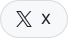
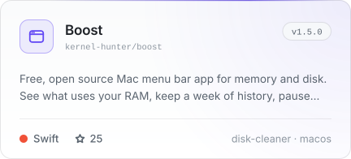
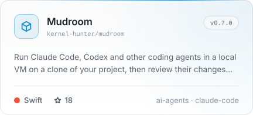
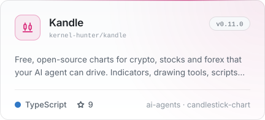
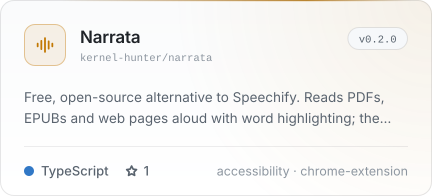
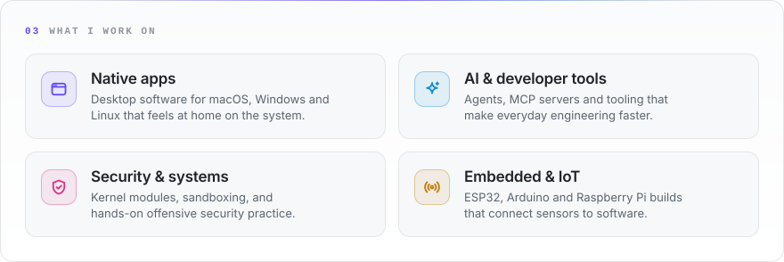

<picture><source media="(prefers-color-scheme: dark)" srcset="assets/dark/hero.svg"></picture>

<a href="https://karimmasmoudi.vercel.app"><picture><source media="(prefers-color-scheme: dark)" srcset="assets/dark/btn-portfolio.svg"></picture></a>&nbsp;<a href="https://www.linkedin.com/in/karim-masmoudi-224816291/"><picture><source media="(prefers-color-scheme: dark)" srcset="assets/dark/btn-linkedin.svg"></picture></a>&nbsp;<a href="https://x.com/Karim__Masmoudi"><picture><source media="(prefers-color-scheme: dark)" srcset="assets/dark/btn-x.svg"></picture></a>&nbsp;<a href="mailto:karim.masmoudi.pro@gmail.com"><picture><source media="(prefers-color-scheme: dark)" srcset="assets/dark/btn-email.svg"></picture></a>

<picture><source media="(prefers-color-scheme: dark)" srcset="assets/dark/about.svg"></picture>

<picture><source media="(prefers-color-scheme: dark)" srcset="assets/dark/section-work.svg"></picture>

<a href="https://github.com/Kernel-Hunter/boost"><picture><source media="(prefers-color-scheme: dark)" srcset="assets/dark/project-boost.svg"></picture></a>
<a href="https://github.com/Kernel-Hunter/mudroom"><picture><source media="(prefers-color-scheme: dark)" srcset="assets/dark/project-mudroom.svg"></picture></a>

<a href="https://github.com/Kernel-Hunter/kandle"><picture><source media="(prefers-color-scheme: dark)" srcset="assets/dark/project-kandle.svg"></picture></a>
<a href="https://github.com/Kernel-Hunter/narrata"><picture><source media="(prefers-color-scheme: dark)" srcset="assets/dark/project-narrata.svg"></picture></a>

<picture><source media="(prefers-color-scheme: dark)" srcset="assets/dark/focus.svg"></picture>

<picture><source media="(prefers-color-scheme: dark)" srcset="assets/dark/stack.svg"></picture>

<picture><source media="(prefers-color-scheme: dark)" srcset="assets/dark/credentials.svg"></picture>

<picture><source media="(prefers-color-scheme: dark)" srcset="assets/dark/activity.svg"></picture>

<a href="https://github.com/Kernel-Hunter?tab=repositories&amp;type=source">all repositories</a> &nbsp;·&nbsp; <a href="mailto:karim.masmoudi.pro@gmail.com">karim.masmoudi.pro@gmail.com</a>

